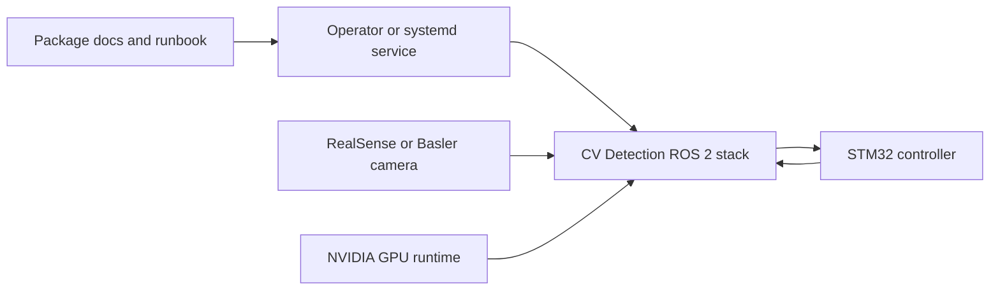
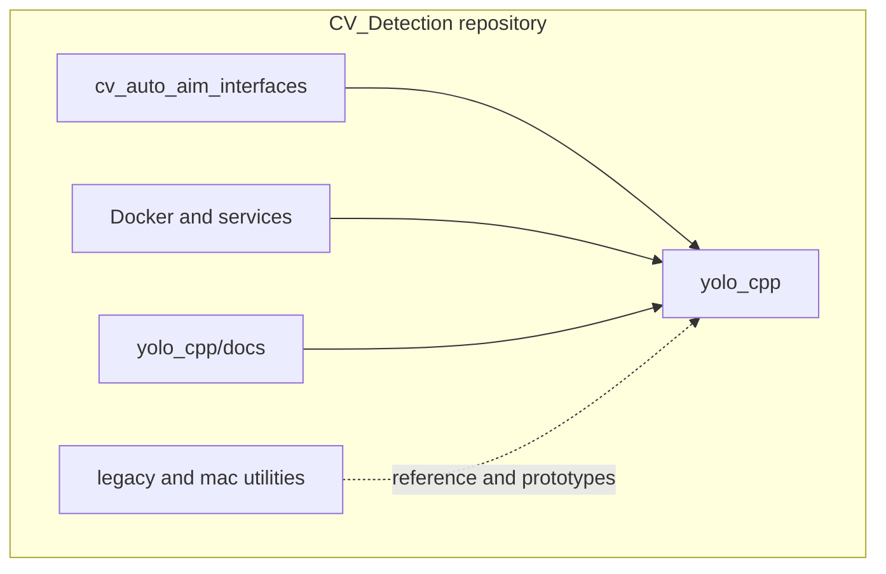
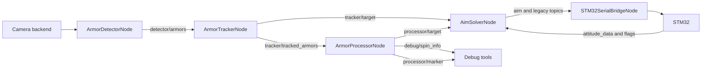
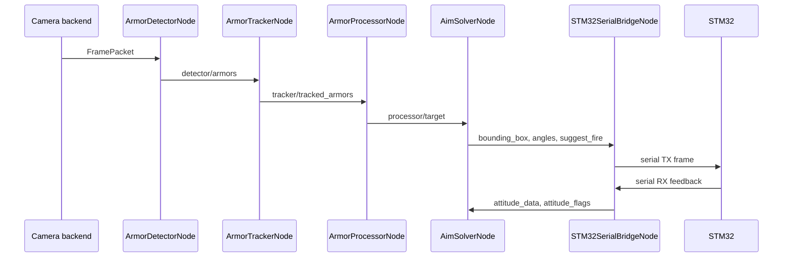

# Architecture: CV Detection

<!-- SCOPE: Architecture, runtime boundaries, component responsibilities, and cross-cutting design concepts for the active ROS 2 auto-aim stack. -->
<!-- DOC_KIND: explanation -->
<!-- DOC_ROLE: canonical -->
<!-- READ_WHEN: Read when you need the system model, runtime flow, component boundaries, or design rationale. -->
<!-- SKIP_WHEN: Skip when you only need operational commands, infrastructure inventory, or package-specific API lookup. -->
<!-- PRIMARY_SOURCES: yolo_cpp/docs/overview.md, yolo_cpp/docs/pipeline.md, yolo_cpp/docs/nodes.md, yolo_cpp/docs/interfaces.md, yolo_cpp/CMakeLists.txt, cv_auto_aim_interfaces/msg -->

## Quick Navigation

| Need | Read |
|------|------|
| Requirements | [requirements.md](requirements.md) |
| Tech stack | [tech_stack.md](tech_stack.md) |
| Runtime operations | [runbook.md](runbook.md) |
| Pattern catalog | [patterns_catalog.md](../architecture/patterns_catalog.md) |
| Package-level architecture | [yolo_cpp overview](../../yolo_cpp/docs/overview.md) |

## Agent Entry

| Signal | Value |
|--------|-------|
| Purpose | Explains how the active ROS 2 vision stack is decomposed and how data moves through it. |
| Read When | You are changing runtime boundaries, message flow, launch composition, or hardware integration. |
| Skip When | You only need exact operator commands or individual message fields. |
| Canonical | Yes |
| Primary Sources | `yolo_cpp/docs/`, `yolo_cpp/CMakeLists.txt`, `cv_auto_aim_interfaces/msg/` |

## 1. Introduction and Goals

CV Detection is the NYU Robomaster auto-aim perception stack. The active implementation is a ROS 2 C++ pipeline in `yolo_cpp` backed by custom message definitions in `cv_auto_aim_interfaces`.

| Goal | Architectural Response |
|------|------------------------|
| Low-latency camera-to-aim loop | Keep the hot path in C++17 with optional GPU-backed TensorRT and DeepStream integrations. |
| Runtime tunability | Expose camera, detector, tracker, processor, solver, and STM bridge behavior through launch parameters. |
| Stage isolation | Use ROS 2 topics and custom messages between detector, tracker, processor, solver, and serial boundary. |
| Hardware flexibility | Compile optional RealSense, Basler Pylon, TensorRT, DeepStream, and GStreamer capabilities only when available. |
| Legacy containment | Preserve older combined paths for reference while documenting the split runtime as the primary architecture. |

## 2. Constraints

| Constraint | Source |
|------------|--------|
| ROS 2 package build uses `ament_cmake` and `colcon`. | [yolo_cpp/CMakeLists.txt](../../yolo_cpp/CMakeLists.txt), [cv_auto_aim_interfaces/CMakeLists.txt](../../cv_auto_aim_interfaces/CMakeLists.txt) |
| Active C++ runtime targets C++17. | [yolo_cpp/CMakeLists.txt](../../yolo_cpp/CMakeLists.txt) |
| GPU runtime path depends on NVIDIA Docker runtime and host devices. | [Docker/docker-compose.yml](../../Docker/docker-compose.yml), [infrastructure.md](infrastructure.md) |
| Basler support requires Pylon headers and libraries visible during build. | [CPP_CONTAINER_RUNBOOK.md](../../CPP_CONTAINER_RUNBOOK.md), [yolo_cpp/CMakeLists.txt](../../yolo_cpp/CMakeLists.txt) |
| Interface compatibility is governed by ROS message definitions. | [cv_auto_aim_interfaces/msg](../../cv_auto_aim_interfaces/msg/Armor.msg) |

## 3. Context and Scope

The system sits between robot hardware and downstream control. Cameras and inference engines produce perception state; the STM32 controller consumes compact aim outputs and provides feedback.

## 4. Solution Strategy

| Decision | Rationale | Evidence |
|----------|-----------|----------|
| Split runtime into ROS 2 stages | Allows detector, tracker, processor, solver, and serial concerns to evolve separately. | [pipeline.md](../../yolo_cpp/docs/pipeline.md) |
| Keep custom message package separate | Lets runtime nodes share contracts without sharing implementation code. | [cv_auto_aim_interfaces](../../cv_auto_aim_interfaces/package.xml) |
| Keep optional hardware SDKs behind CMake detection | Supports development on machines without every robot hardware dependency installed. | [yolo_cpp/CMakeLists.txt](../../yolo_cpp/CMakeLists.txt) |
| Preserve combined nodes as reference paths | Useful for comparison and zero-copy experiments while the split stack remains canonical. | [nodes.md](../../yolo_cpp/docs/nodes.md), [zerocopy.launch.py](../../yolo_cpp/launch/zerocopy.launch.py) |

## 5. Building Block View

### 5.1 Container View

### 5.2 Runtime Component View

### 5.3 Key Components

| Component | Responsibility | Source |
|-----------|----------------|--------|
| `CameraNode` and camera backend | Camera-facing frame acquisition and `image_raw` publication path. | [camera_node.hpp](../../yolo_cpp/include/yolo_cpp/camera_node.hpp), [camera_backend.hpp](../../yolo_cpp/include/yolo_cpp/camera_backend.hpp) |
| `ArmorDetectorNode` | Camera capture, detector backend setup, candidate extraction, optional PnP, and `detector/armors` publication. | [armor_detector_node.hpp](../../yolo_cpp/include/yolo_cpp/armor_detector_node.hpp) |
| `ArmorTrackerNode` | Temporal tracking, target selection, and publication of tracked sets and selected target. | [armor_tracker_node.hpp](../../yolo_cpp/include/yolo_cpp/armor_tracker_node.hpp), [tracker.hpp](../../yolo_cpp/include/yolo_cpp/tracker.hpp) |
| `ArmorProcessorNode` | Target-frame transform, smoothing, velocity, spin observer, and visualization output. | [armor_processor_node.hpp](../../yolo_cpp/include/yolo_cpp/armor_processor_node.hpp) |
| `AimSolverNode` | 3D or 2D yaw/pitch solving, fire recommendation, and controller-facing topic output. | [aim_solver_node.hpp](../../yolo_cpp/include/yolo_cpp/aim_solver_node.hpp) |
| `STM32SerialBridgeNode` | Serial protocol boundary to the STM32 controller. | [stm32_serial_bridge_node.hpp](../../yolo_cpp/include/yolo_cpp/stm32_serial_bridge_node.hpp), [seasky_protocol.hpp](../../yolo_cpp/include/yolo_cpp/seasky_protocol.hpp) |
| `PerceptionNode` | Older combined runtime and zero-copy experiment target. | [perception_node.hpp](../../yolo_cpp/include/yolo_cpp/perception_node.hpp) |
| `YoloNode` | Older combined-style image subscriber path. | [yolo_node.hpp](../../yolo_cpp/include/yolo_cpp/yolo_node.hpp) |

## 6. Runtime View

### 6.1 Basler Field Launch

`basler.launch.py` is the full Basler + DeepStream camera-to-controller launch path. It exposes Basler source format, model path, serial port, tracking thresholds, 3D solving, and STM bridge settings. `stm.launch.py` remains as a compatibility alias for existing scripts.

### 6.2 RealSense-Only Launch

`realsense.launch.py` starts RealSense capture, native TensorRT detection, tracker, processor, and solver without the serial bridge. It is the lighter runtime for camera and solver bring-up.

### 6.3 Zero-Copy Experiment

`zerocopy.launch.py` runs the legacy combined `PerceptionNode` inside a composable container with intra-process communication enabled.

## 7. Crosscutting Concepts

| Concept | Current Approach |
|---------|------------------|
| Interface contracts | ROS messages in `cv_auto_aim_interfaces/msg` define detector, tracker, target, spin, and solver outputs. |
| Configuration | Launch files declare runtime parameters; `services/uv.sh` wraps common build and run commands. |
| Optional dependencies | CMake sets `HAVE_GSTREAMER`, `HAVE_LIBREALSENSE2`, `HAVE_TENSORRT`, `HAVE_DEEPSTREAM`, and `HAVE_PYLON` when headers and libraries are available. |
| Hardware access | Docker runtime uses host networking, privileged mode, NVIDIA runtime, `/dev`, USB, camera sockets, and optional `/opt/pylon` mount. |
| Debugging | Runtime emits debug image, spin info, marker, legacy topic, and `AimSolution` outputs where enabled. |
| Legacy compatibility | Solver and serial bridge preserve legacy controller-facing topics while adding typed `AimSolution`. |

## 8. Architecture Decisions

No formal ADR files are present in the current repository. When adding formal ADRs, place them under `docs/reference/adrs/` or update this section with the chosen canonical ADR path.

| Decision | Status | Source |
|----------|--------|--------|
| Use split detector, tracker, processor, solver, and bridge nodes as the active runtime | Accepted in current code | [overview.md](../../yolo_cpp/docs/overview.md) |
| Keep `cv_auto_aim_interfaces` as the shared message package | Accepted in current code | [cv_auto_aim_interfaces/package.xml](../../cv_auto_aim_interfaces/package.xml) |
| Keep combined `PerceptionNode` and `YoloNode` as legacy/reference paths | Accepted in current code | [nodes.md](../../yolo_cpp/docs/nodes.md) |
| Run production-like robot stack through NVIDIA Docker images | Accepted in current ops scripts | [Docker/docker-compose.yml](../../Docker/docker-compose.yml), [services/start-container.sh](../../services/start-container.sh) |

## 9. Quality Requirements

| Quality | Architectural Mechanism |
|---------|-------------------------|
| Latency | C++ hot path, GPU inference options, host networking, and ROS component support. |
| Reliability | Stage-level topic boundaries and configurable fallback when 3D pose is unavailable. |
| Maintainability | Separate ROS packages for runtime and messages, package-level docs, and clear legacy directories. |
| Portability | Optional dependency detection and Docker wrappers for Jetson, Linux, macOS, and Windows fallback paths. |
| Observability | Debug topics, stage logs, ROS topic inspection, and service logs. |

## 10. Risks and Technical Debt

| Risk | Impact | Mitigation |
|------|--------|------------|
| Optional hardware SDKs can be absent at build time. | Runtime features compile out and launch settings may fail if mismatched. | Check CMake configure output and rebuild after installing Pylon or GPU SDKs. |
| Root scripts and compose paths assume robot-specific host layout. | New machines may need setup work before `uv` commands work. | Keep [runbook.md](runbook.md) aligned with `services/` scripts. |
| Legacy paths remain in the repository. | Agents may edit reference code instead of active runtime. | Start from `yolo_cpp/docs/overview.md` and this architecture doc for runtime work. |
| CI release workflow does not build the ROS workspace. | Runtime regressions may not be caught by hosted CI. | Run container/colcon checks before merging runtime changes. |

## Maintenance

**Update Triggers:**
- New ROS node, executable, launch file, topic, or message
- Major detector, tracker, processor, solver, or STM bridge behavior change
- Docker image or hardware integration change
- Formal ADR path is introduced

**Verification:**
- [ ] C4 and sequence diagrams still match the launch files
- [ ] Component table paths exist
- [ ] Runtime flow matches `yolo_cpp/docs/pipeline.md`
- [ ] Optional dependency claims match `yolo_cpp/CMakeLists.txt`

**Last Updated:** 2026-05-15
